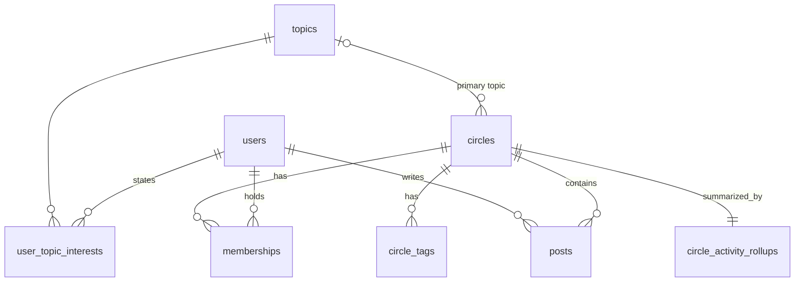

# Database Schema

The DDL is in [`src/db/schema.sql`](../src/db/schema.sql). `npm run seed` rebuilds the database from `data/*.json`.

## Tables

| Table | Key | Purpose |
| --- | --- | --- |
| `topics` | `id`, unique `slug` | The topic taxonomy |
| `users` | `id` | Member profile |
| `user_topic_interests` | `(user_id, topic_id)` | Stated interests |
| `circles` | `id`, unique `slug` | Circle profile, capacity and activity aggregates. `topic_id` and `max_members` are nullable. |
| `circle_tags` | `(circle_id, tag)` | Free-form tags |
| `memberships` | `(user_id, circle_id)` | Who belongs where. Leaders are members with `role = 'leader'`. |
| `posts` | `id` | Circle feed posts with engagement counts |
| `circle_activity_rollups` | `circle_id` | Newest post time and 30-day engagement per post, derived from `posts` |
| `app_meta` | `key` | The dataset's snapshot time |

## Design decisions

- **Join tables instead of JSON arrays.** Interests and tags are normalized so "who cares about this topic?" and "which Circles have this tag?" can use an index, and foreign keys reject unknown topics.
- **Tags stay as text.** The source calls them free-form, so tying them to `topics` would reject legitimate values later. The primary key also removes repeated tags, which the seed has (#17).
- **"Full" isn't stored.** It's derived from `member_count` and `max_members`, as the dataset suggests, so a stored flag can't drift out of sync.
- **Enums use `CHECK` constraints.** Invalid values fail at insert. In Postgres these could become native enums.
- **Timestamps are ISO-8601 UTC text.** All are written in the same format, so they sort correctly as text in SQLite. Postgres would use `timestamptz`.
- **`member_count` and the 30-day counters are kept on `circles`,** as the source provides them. This avoids counting rows on every read, at the cost of needing to keep them updated in production.
- **Activity is rolled up.** Engagement comes from `posts`, but a recommendation request shouldn't aggregate posts every time. A seed-time rollup stands in for a scheduled job.

## Indexes

| Index | Query it serves | Why |
| --- | --- | --- |
| `memberships` PK `(user_id, circle_id)` | A member's Circles, for exclusion and related topics | Runs on every request, and also prevents duplicate memberships |
| `memberships_by_circle (circle_id, role)` | A Circle's roster and leaders | The primary key only covers lookups by user |
| `user_topic_interests` PK | A member's interests | Runs on every request |
| `circles_listed_by_topic (topic_id) WHERE access = 'public'` | Candidate Circles by topic | Partial, so unlisted Circles aren't reachable through it and the index stays small |
| `circle_tags_by_tag (tag, circle_id)` | Circles by tag | Reverse of the primary key |
| `posts_by_circle_recent (circle_id, created_at DESC)` | The rollup, and a Circle's feed | Avoids a full scan as `posts` becomes the largest table |

**Not indexed on purpose:** `feed_posts_30d`, `last_activity_at` and `member_count`. They change constantly, which makes index upkeep expensive, and they're read for rows already chosen by topic.

**Honest caveat:** at 40 Circles, the current code loads every Circle on each request, so `circles_listed_by_topic` and `circle_tags_by_tag` aren't used yet. They're there for the production path in the [design doc](DESIGN.md), where candidates would be retrieved by topic. The member lookups do use their primary keys today.
